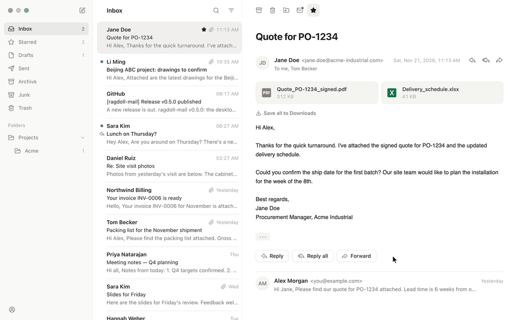
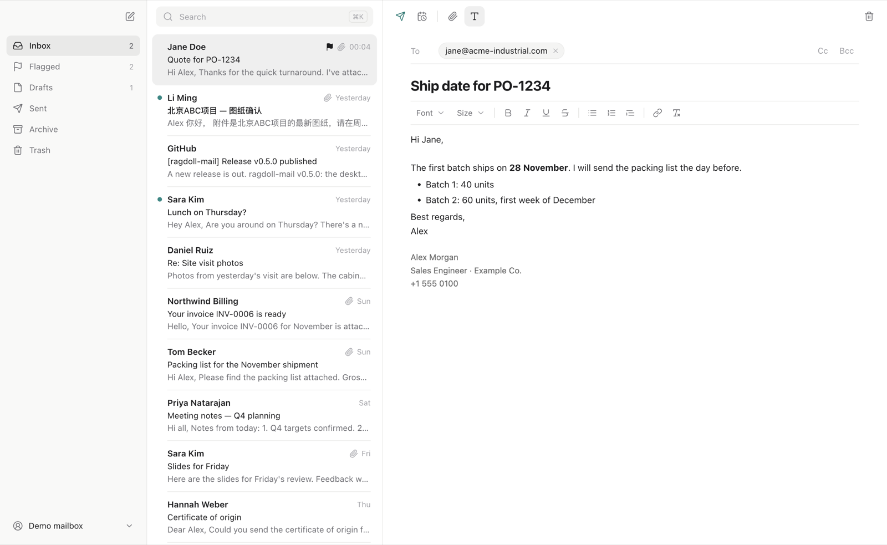

<p align="center"></p>

<h1 align="center">ragdoll-mail</h1>

<p align="center"><b>A calm, fast mail app for one IMAP mailbox, with a command line your AI agent can drive.</b><br>
Mac and Windows · light and dark · 8 languages · your mail stays on your computer</p>

<p align="center">
  <a href="https://github.com/erict16/ragdoll-mail/releases/latest"><b>Download for Mac</b></a> ·
  <a href="https://github.com/erict16/ragdoll-mail/releases/latest"><b>Download for Windows</b></a> ·
  <a href="#command-line">Command line</a>
</p>

<p align="center"></p>

## Why it feels fast

ragdoll keeps its own index of your mailbox in SQLite. Opening a folder takes about a millisecond, and search finds Chinese and English text in any part of a mail, even on servers that ignore IMAP search (Tencent Exmail is one). The list does not wait for the network: new mail comes in behind it.

<table>
<tr><td></td><td></td></tr>
<tr><td></td><td></td></tr>
</table>

## What you get

**Read**
- Whole conversations on one page, newest mail on top. Long quoted history folds away.
- Search everything with ⌘K / Ctrl+K: `from:jane`, `in:sent`, `is:unread`, `has:attachment`, or any words.
- Flag mail with **S** and find it again in **Flagged**. Select many rows with ⌘/Ctrl or Shift and act on them at once.
- Text size from ⌘− to ⌘+, for the list and the reader together.

**Write**
- A real editor: font and size, bold, italic, underline, lists, quotes and links. Paste from Word or a web page and only the formatting that mail clients show is kept.
- Your signature, made in Settings with the same editor, goes under every new mail, reply and forward.
- A default font and size for every mail you write.
- Reply, reply all and forward keep the quoted history and its inline images.
- Before a mail goes out, the app checks it: empty To or subject, a missing attachment the text talks about, placeholders such as `[Name]` or `TBD`, broken characters.

**Send on your terms**
- **Undo send:** the mail waits 5, 10, 20 or 30 seconds (your choice) before it leaves. Press Undo and it goes back to the editor.
- **Send later:** pick this evening, tomorrow morning, Monday, or any date and time. Scheduled mail waits in **Scheduled**, where you can change it, send it now, or cancel it.
- **Plain truth about recall:** once a mail has left your computer, no app can take it back from the other person's inbox. ragdoll gives you the undo window and scheduled send instead, so you can stop a mail before it goes.

**Make it yours**
- Light, dark, or follow the system. Native window on Mac and Windows.
- English, 简体中文, 繁體中文, 日本語, 한국어, Español, Français, Deutsch.
- Show times in any time zone.
- Keyboard first: **J/K** move, **R** reply, **A** reply all, **F** forward, **E** archive, **#** delete, **U** unread, **C** new mail. Press **?** to see them all.
- Small windows get a slim icon sidebar; very small ones show the list and the mail one at a time.

**Private by design**
- Mail is indexed on your computer. Nothing goes to any server except your own mail server.
- The password is kept in the macOS Keychain or the Windows Credential Manager, never in a file.
- The app only listens on 127.0.0.1, and every call needs a random token made at start.

## Install

- **Download:** [Releases](https://github.com/erict16/ragdoll-mail/releases/latest): `ragdoll-mail-mac.dmg` (Apple silicon) or `ragdoll-mail-windows.zip`. The builds are not signed: on macOS right-click the app and choose **Open** the first time; on Windows choose **More info → Run anyway**. Windows needs the WebView2 runtime (built into Windows 11).
- **From a clone:** `pip install pywebview`, then `ragdoll app`. Without pywebview it opens in the browser.
- **Just looking?** `ragdoll app --demo` opens a made-up mailbox. No account, nothing is sent.

## Command line

`ragdoll` is the same mailbox from the terminal, made to be driven by an AI agent (Claude Code) and checked by a person. One Python file, standard library only, Windows and macOS.

Why it exists: some servers ignore IMAP text search, so every `SEARCH SUBJECT/FROM/BODY` returns the whole mailbox. ragdoll keeps its own SQLite index with trigram full-text search, so Chinese and English both work, and does drafts the way a person would: signature, quoted history with its images, attachments, then a check before anything is sent.

### Setup

1. Python 3.10+ (SQLite 3.34+ for the trigram index; the python.org builds have it).
2. Copy `config.example.json` to `~/.config/ragdoll-mail/config.json` and fill it in. Dates use the computer's time zone; add `"utc_offset_hours": 8` (for example) to use a fixed one.
3. Put the IMAP app password in the environment variable named by `password_env` (or sign in once in the desktop app, which saves it in the system keychain). Windows (stays set for new programs):
   ```powershell
   [Environment]::SetEnvironmentVariable('RAGDOLL_PASSWORD', '<password>', 'User')
   ```
   macOS: `export RAGDOLL_PASSWORD=...` in your shell profile. ragdoll never prints it.
4. Make the `ragdoll` command. macOS / Linux (with `~/.local/bin` on your PATH):
   ```sh
   printf '#!/bin/sh\nexec python3 -I "%s/ragdoll.py" "$@"\n' "$PWD" > ~/.local/bin/ragdoll && chmod +x ~/.local/bin/ragdoll
   ```
   Windows: a `ragdoll.cmd` with `@python -I "%USERPROFILE%\Github\ragdoll-mail\ragdoll.py" %*` in a folder on your PATH. `ragdoll ...` always works too.
5. First index: `ragdoll sync --bodies` (headers first, then bodies on 4 connections). Later commands only fetch what is new.

### Commands

```
ragdoll status
ragdoll search PO-1234 报价 --since 2026-11-01 --att
ragdoll thread inbox:9255
ragdoll read inbox:9255 --new
ragdoll attach inbox:9255 --out ./files
ragdoll draft --reply inbox:9255 --all --cc a@b.com --body body.html --attach file.pdf
ragdoll check drafts:12 --reply
ragdoll send drafts:12 --yes
```

`ragdoll --help` lists every option. Ids are `<folder>:<uid>`. Add `--json` for machine output.

#### How drafts work

`draft` writes only the new text you give it, then adds the signature file, a quote header and the original mail (with its inline images), and saves the result in the server's Drafts folder, so it shows up in the normal mail apps. To change a draft, build it again with `--replace drafts:<old>`. `check` fails on a missing signature or quote, a lost image, an empty To or subject, the sender as a recipient, a missing required Cc, garbled characters (�) in names, subject, text or file names, placeholders left in the text (`[Name]`, `XXX`, `TBD`, `待定`; `--blanks-ok` to allow), text that mentions an attachment when none is attached (`--attach-ok` to allow), and email tables that will render badly. `send` sends a draft over SMTP with the current date, makes sure one copy is in Sent (Exmail files its own and rewrites the Message-ID as `<XXXX+id>`), deletes the draft and marks the original answered. Every sent Message-ID goes to `sent.log` in the data dir; sending the same draft again is refused, and if tidying up fails after the mail went out, the output says so instead of inviting a second send. `--replace`, `send` and `delete-draft` only touch the Drafts folder.

Text in GB2312, GBK, GB18030 and Big5 is read with the superset codecs (GB18030, cp950), so names such as 陈喆 labelled GB2312 stay intact; raw 8-bit GBK headers and file names are repaired, unknown charsets never stop a sync, and an attached mail (message/rfc822) is kept as one .eml attachment.

### Updates

ragdoll updates itself the careful way (the model is S2Arm's updater):

- **It looks, it does not touch.** At most every 6 hours a command starts a quiet background check (`git fetch` of `main`, never asks for a password, never slows the command). When a newer version is waiting, commands print one line on stderr: `ragdoll 0.4.1 is out (2 change(s); this is 0.4.0). Run: ragdoll update`. No network, no line. `status` shows `version` and `update_available`.
- **It replaces only when asked:** `ragdoll update` (`--check` only says what is new). It refuses while another ragdoll command runs (a sync, a send), when the clone has changed files, is not on `main`, or has commits that are not on GitHub.
- **It tests before it keeps.** After the fast-forward it runs `ragdoll.py --version` and the offline tests of the new version. If they fail, it puts the old version back by itself and says why.
- **It says what changed** (the commit titles) and logs every step to `<data dir>/logs/update.log`.
- **One step back:** `ragdoll update --rollback` returns to the version before the last update and stops offering the one you left.

Off: `"update_check": false` in the config, or `RAGDOLL_NO_UPDATE_CHECK=1`. `RAGDOLL_UPDATE_REMOTE` points the check at another remote (for testing). Updating needs a git clone; a copied `ragdoll.py` only says so.

## Renamed from hmail

Before 0.4.0 the program was `hmail` (`hmail.py`, `~/.config/hmail`, `~/.local/share/hmail`, `HMAIL_*` variables). The first run of 0.4.0 moves both folders to their new names and fixes the paths in the config; the `HMAIL_*` variables still work. `hmail.py` stays as a thin alias so older copies can update and `import hmail` keeps working. `update --rollback` will not go back past the rename.

## Tests

```
python -m unittest discover -s tests
```

The tests are offline; they build and check messages without a server.
