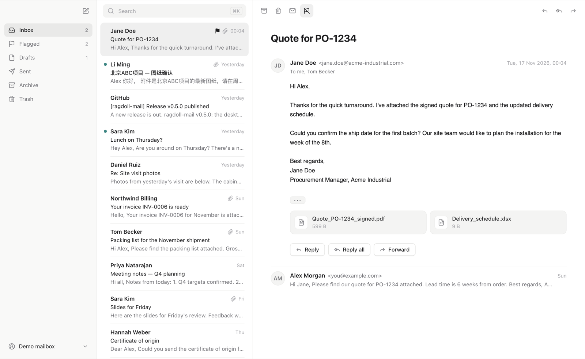
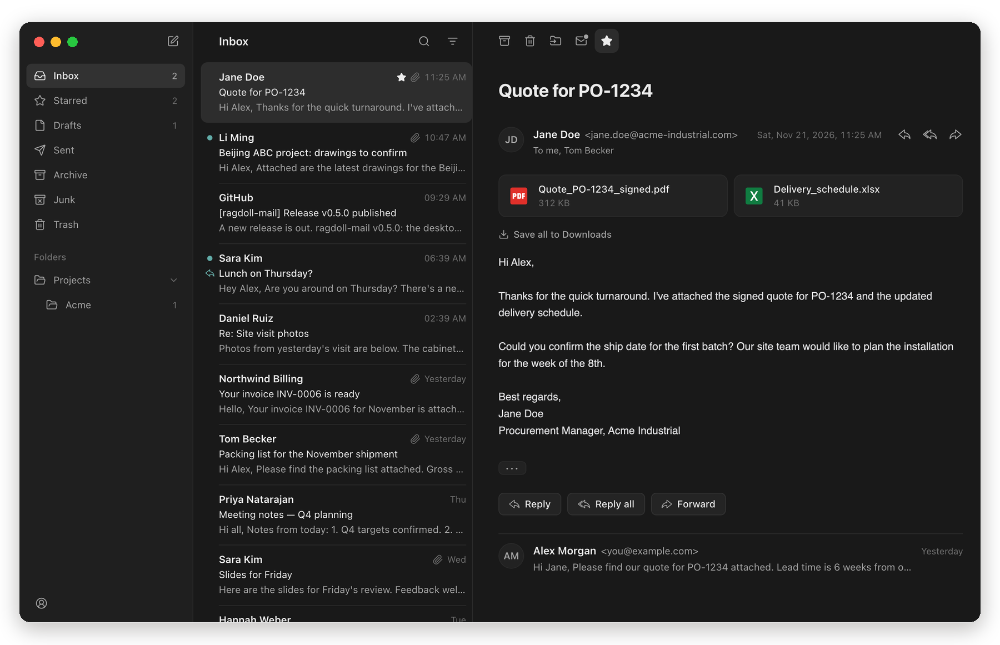
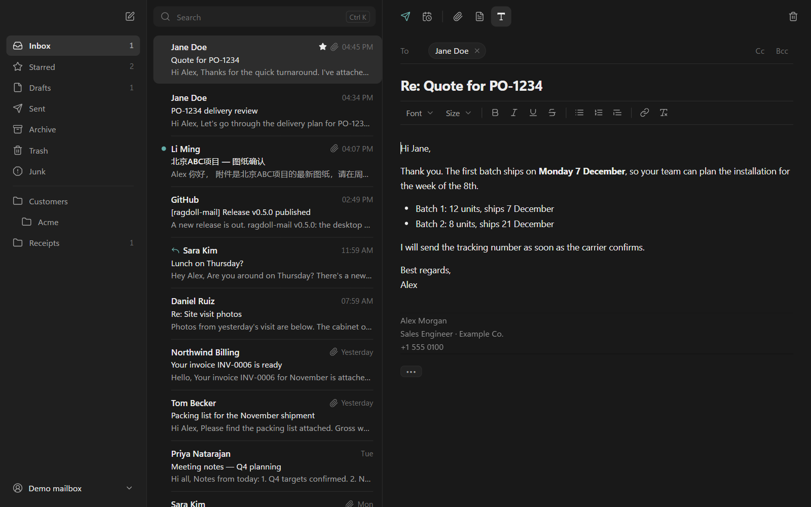

<p align="center"></p>

<h1 align="center">ragdoll-mail</h1>

<p align="center"><b>Mail search that works, on your own computer.<br>Every mail in milliseconds, for you and your AI agent.</b></p>

<p align="center">Any IMAP mailbox · local SQLite index · Chinese and English · desktop app and <code>--json</code> command line · Mac and Windows · free and open source</p>

<p align="center">
  <a href="https://github.com/erict16/ragdoll-mail/releases/latest"></a>
  <a href="https://github.com/erict16/ragdoll-mail/actions/workflows/build.yml"></a>
  
  <a href="LICENSE"></a>
</p>

<p align="center">
  <a href="https://github.com/erict16/ragdoll-mail/releases/latest"><b>Download for Mac</b></a> ·
  <a href="https://github.com/erict16/ragdoll-mail/releases/latest"><b>Download for Windows</b></a> ·
  <a href="#search-that-works">Search</a> ·
  <a href="#the-command-line">The command line</a> ·
  <a href="#how-it-compares">How it compares</a>
</p>

<p align="center"></p>

Most mail apps ask your mail server to search, and many servers do it badly, slowly, or not at all. ragdoll keeps its own full-text index of your mailbox on your computer, so search is instant, works offline, and finds words in the body, the people and the attachment names. You get it in a calm desktop app, and your agent (Claude Code, Codex, or any script) gets the same index through the `ragdoll` command.

## Search that works

A real mailbox on Tencent Exmail, 6,442 mails, searched both ways:

| Search for | The server's IMAP search | ragdoll |
|---|---|---|
| `invoice` | 4,988 results (the whole inbox) | the matching mails, 15 ms |
| `certificate origin` | 4,988 results (the whole inbox) | the matching mails, 8 ms |
| `报价` (Chinese: "quotation") | 4,988 results (the whole inbox) | the matching mails, 23 ms |
| `nonexistentzzq` (a made-up word) | 4,988 results (the whole inbox) | none, 0.4 ms |

<sub>Measured 18 Nov 2026 on Windows 11. ragdoll times are the search itself, best of 5, on a 382 MB index.</sub>

- **One index, every part of a mail.** Subject, sender, recipients, attachment file names and the full body text, in a SQLite FTS5 trigram index.
- **Chinese, Japanese and Korean too.** Trigrams need no word splitting, so `分接开关` or `見積` are found inside running text. Two-letter words such as `PO` or `报价` still work.
- **All words must match,** with filters: `--from`, `--to`, `--since`, `--until`, `--folder`, `--unread`, `--att`. In the app: `from:jane in:sent is:unread has:attachment`.
- **Offline.** On a plane, on a bad hotel network, or when the server is down, search still answers from the index.
- **The list never waits for the network.** Opening a folder takes about a millisecond; new mail comes in behind it.
- **Your agent gets the same search.** `ragdoll search ... --json` gives an agent exact hits instead of a whole mailbox to read, so it spends fewer tokens and makes fewer mistakes.

## Agents draft. You send.

```console
you    › Reply to Lucas, attach the certificate of origin, cc Bao.

agent  $ ragdoll search Lucas "certificate of origin" --since 2026-11-01 --json
agent  $ ragdoll thread inbox:312 --json
agent  $ ragdoll draft --reply inbox:312 --cc bao.tran@saigon-grid.example \
              --body reply.html --attach CO-4471.pdf
agent  $ ragdoll check drafts:14 --reply
         To:      Lucas Martin <lucas.martin@blueharbor.example>
         Cc:      bao.tran@saigon-grid.example
         Subject: Re: Order 4471 - shipping documents
         Attach:  CO-4471.pdf (212 KB)
         CHECK OK

agent  › The draft is in your Drafts folder. Shall I send it?
you    › Yes.
agent  $ ragdoll send drafts:14 --yes
```

Every step is a plain command with `--json` output, so any agent can learn it from `ragdoll --help`. Nothing leaves your computer until a person says so:

- **Drafts go where you can see them.** `draft` saves to your server's real Drafts folder, with your signature, the quoted history and its inline images. Open it in ragdoll, your phone or any mail app before anything is sent.
- **A check before every send.** `check` fails on an empty To or subject, a missing signature, lost images, garbled characters (�), the sender as a recipient, a missing required Cc, placeholders such as `[Name]`, `XXX` or `TBD` left in the text, and text that says "attached" when nothing is.
- **No double sends.** Every sent Message-ID is logged. Sending the same draft twice is refused. If tidying up fails after a mail has gone, ragdoll says so instead of inviting a second send.
- **Nothing is destroyed by accident.** `send`, `trash` and `delete-draft` need `--yes`. Trash moves mail to the Trash folder, where you can get it back.
- **No API quota, no OAuth app, no vendor.** ragdoll talks plain IMAP and SMTP to your own mail server. The password stays in the system keychain and is never printed.

### Teach your agent in one paragraph

Put this in your `CLAUDE.md`, `AGENTS.md` or system prompt:

```markdown
Mail: use the `ragdoll` command (`ragdoll --help` lists everything; add --json).
Find with `search` / `thread`, read with `read --new`, write with `draft --reply <id>`,
then run `check <draft id> --reply` and fix every problem. Never run `send` until I
have said yes to that draft.
```

## Screenshots

<table>
<tr><td></td><td></td></tr>
<tr><td></td><td></td></tr>
</table>

## How it compares

|  | **ragdoll** | Thunderbird | Superhuman | Spark | Shortwave | himalaya | NeoMutt / aerc |
|---|:---:|:---:|:---:|:---:|:---:|:---:|:---:|
| Any IMAP mailbox | ✅ | ✅ | Gmail, Outlook | ✅ | Gmail only | ✅ | ✅ |
| Desktop app | ✅ | ✅ | ✅ | ✅ | ✅ | — | terminal UI |
| Command line an agent can drive (`--json`) | ✅ | — | — | — | — | ✅ | — |
| Local full-text search (works when server search doesn't) | ✅ | ✅ | — | — | — | — | with notmuch |
| Checks a draft before it is sent | ✅ | attachment reminder | — | — | — | — | — |
| Mail stays on your computer, no vendor cloud | ✅ | ✅ | — | — | — | ✅ | ✅ |
| Free and open source | ✅ MIT | ✅ | paid | free tier, closed | free tier, closed | ✅ | ✅ |

**In short:** Thunderbird is a great desktop client with no way for an agent in. himalaya is a great CLI with no app for you. Superhuman, Spark and Shortwave are polished, but they run through their own cloud and cost a subscription for the good parts. ragdoll is the one place where you and your agent work on the same mailbox, on your own machine.

### For agents: ragdoll vs. the usual ways in

|  | **ragdoll** | Gmail API / MCP connector | Your own IMAP script |
|---|:---:|:---:|:---:|
| Works with Exmail, QQ, 163, iCloud, Fastmail, any IMAP | ✅ | Gmail only | ✅ |
| No API quota or OAuth app to register | ✅ | — | ✅ |
| Fast local search in Chinese and English | ✅ | server search | write it yourself |
| Replies keep signature, quote and inline images | ✅ | partly | write it yourself |
| Pre-send check and double-send guard | ✅ | — | write it yourself |
| A human app on the same mailbox | ✅ | Gmail web | — |

<sub>Compared from each product's public pages, November 2026. Something wrong or out of date? <a href="https://github.com/erict16/ragdoll-mail/issues">Open an issue</a> and we will fix it.</sub>

## What you get in the app

**Read**
- Whole conversations on one page, newest mail on top. Long quoted history folds away.
- Search everything with ⌘K / Ctrl+K: `from:jane`, `in:sent`, `is:unread`, `has:attachment`, or any words.
- Star mail with **S** and find it again in **Starred**. Select many rows with ⌘/Ctrl or Shift and act on them at once.
- Text size from ⌘− to ⌘+, for the list and the reader together.

**Write**
- A real editor: font and size, bold, italic, underline, lists, quotes and links. Paste from Word or a web page and only the formatting that mail clients show is kept.
- Your signature, made in Settings with the same editor, goes under every new mail, reply and forward.
- A default font and size for every mail you write.
- Reply, reply all and forward keep the quoted history and its inline images.
- The same pre-send check as the command line: empty To or subject, a missing attachment the text talks about, placeholders such as `[Name]` or `TBD`, broken characters.

**Send on your terms**
- **Undo send:** the mail waits 5, 10, 20 or 30 seconds (your choice) before it leaves. Press Undo and it goes back to the editor.
- **Send later:** this evening, tomorrow morning, Monday, or any date and time. Scheduled mail waits in **Scheduled**, where you can change it, send it now, or cancel it.
- **Plain truth about recall:** once a mail has left your computer, no app can take it back from the other person's inbox. ragdoll gives you the undo window and scheduled send instead, so you can stop a mail before it goes.

**Make it yours**
- Light, dark, or follow the system. Native window on Mac and Windows.
- English, 简体中文, 繁體中文, 日本語, 한국어, Español, Français, Deutsch.
- Show times in any time zone.
- Keyboard first: **J/K** move, **R** reply, **A** reply all, **F** forward, **E** archive, **#** delete, **U** unread, **C** new mail. Press **?** to see them all.
- Small windows get a slim icon sidebar; very small ones show the list and the mail one at a time.

**Private by design**
- Mail is indexed on your computer. Nothing goes to any server except your own mail server.
- The password is kept in the macOS Keychain or the Windows Credential Manager, never in a file.
- The app only listens on 127.0.0.1, and every call needs a random token made at start.

**Made for mail in Chinese, too**
- Text in GB2312, GBK, GB18030 and Big5 is read with the superset codecs, so names such as 陈喆 labelled GB2312 stay intact.
- Raw 8-bit GBK headers and file names are repaired, and an unknown charset never stops a sync.
- Presets for Tencent Exmail, QQ Mail and NetEase 163, next to Gmail, iCloud and Fastmail.

## Install

- **Download:** [Releases](https://github.com/erict16/ragdoll-mail/releases/latest): `ragdoll-mail-mac.dmg` (Apple silicon) or `ragdoll-mail-windows.zip`. The builds are not signed: on macOS right-click the app and choose **Open** the first time; on Windows choose **More info → Run anyway**. Windows needs the WebView2 runtime (built into Windows 11).
- **From a clone:** `pip install pywebview`, then `ragdoll app`. Without pywebview it opens in the browser.
- **Just looking?** `ragdoll app --demo` opens a made-up mailbox. No account, nothing is sent.

## The command line

`ragdoll` is the same mailbox from the terminal. One Python file, standard library only, Windows and macOS.

### Setup

1. Python 3.10+ (SQLite 3.34+ for the trigram index; the python.org builds have it).
2. Copy `config.example.json` to `~/.config/ragdoll-mail/config.json` and fill it in. Dates use the computer's time zone; add `"utc_offset_hours": 8` (for example) to use a fixed one.
3. Put the IMAP app password in the environment variable named by `password_env` (or sign in once in the desktop app, which saves it in the system keychain). Windows (stays set for new programs):
   ```powershell
   [Environment]::SetEnvironmentVariable('RAGDOLL_PASSWORD', '<password>', 'User')
   ```
   macOS: `export RAGDOLL_PASSWORD=...` in your shell profile. ragdoll never prints it.
4. Make the `ragdoll` command. macOS / Linux (with `~/.local/bin` on your PATH):
   ```sh
   printf '#!/bin/sh\nexec python3 -I "%s/ragdoll.py" "$@"\n' "$PWD" > ~/.local/bin/ragdoll && chmod +x ~/.local/bin/ragdoll
   ```
   Windows: a `ragdoll.cmd` with `@python -I "%USERPROFILE%\Github\ragdoll-mail\ragdoll.py" %*` in a folder on your PATH. `python ragdoll.py ...` always works too.
5. First index: `ragdoll sync --bodies` (headers first, then bodies on 4 connections). Later commands only fetch what is new.

### Commands

```
ragdoll status
ragdoll search PO-1234 报价 --since 2026-11-01 --att
ragdoll thread inbox:9255
ragdoll read inbox:9255 --new
ragdoll attach inbox:9255 --out ./files
ragdoll draft --reply inbox:9255 --all --cc a@b.com --body body.html --attach file.pdf
ragdoll check drafts:12 --reply
ragdoll send drafts:12 --yes
```

`ragdoll --help` lists every option. Ids are `<folder>:<uid>`. Add `--json` for machine output.

<details>
<summary><b>How drafts work, in detail</b></summary>

`draft` writes only the new text you give it, then adds the signature file, a quote header and the original mail (with its inline images), and saves the result in the server's Drafts folder, so it shows up in the normal mail apps. To change a draft, build it again with `--replace drafts:<old>`.

`check` fails on a missing signature or quote, a lost image, an empty To or subject, the sender as a recipient, a missing required Cc, garbled characters (�) in names, subject, text or file names, placeholders left in the text (`[Name]`, `XXX`, `TBD`, `待定`; `--blanks-ok` to allow), text that mentions an attachment when none is attached (`--attach-ok` to allow), and email tables that will render badly.

`send` sends a draft over SMTP with the current date, makes sure one copy is in Sent (Exmail files its own and rewrites the Message-ID as `<XXXX+id>`), deletes the draft and marks the original answered. Every sent Message-ID goes to `sent.log` in the data dir; sending the same draft again is refused, and if tidying up fails after the mail went out, the output says so instead of inviting a second send. `--replace`, `send` and `delete-draft` only touch the Drafts folder.

An attached mail (message/rfc822) is kept as one .eml attachment.

</details>

<details>
<summary><b>Updates</b></summary>

ragdoll updates itself the careful way (the model is S2Arm's updater):

- **It looks, it does not touch.** At most every 6 hours a command starts a quiet background check (`git fetch` of `main`, never asks for a password, never slows the command). When a newer version is waiting, commands print one line on stderr: `ragdoll 0.4.1 is out (2 change(s); this is 0.4.0). Run: ragdoll update`. No network, no line. `status` shows `version` and `update_available`.
- **It replaces only when asked:** `ragdoll update` (`--check` only says what is new). It refuses while another ragdoll command runs (a sync, a send), when the clone has changed files, is not on `main`, or has commits that are not on GitHub.
- **It tests before it keeps.** After the fast-forward it runs `ragdoll.py --version` and the offline tests of the new version. If they fail, it puts the old version back by itself and says why.
- **It says what changed** (the commit titles) and logs every step to `<data dir>/logs/update.log`.
- **One step back:** `ragdoll update --rollback` returns to the version before the last update and stops offering the one you left.

Off: `"update_check": false` in the config, or `RAGDOLL_NO_UPDATE_CHECK=1`. `RAGDOLL_UPDATE_REMOTE` points the check at another remote (for testing). Updating needs a git clone; a copied `ragdoll.py` only says so.

</details>

<details>
<summary><b>Renamed from hmail</b></summary>

Before 0.4.0 the program was `hmail` (`hmail.py`, `~/.config/hmail`, `~/.local/share/hmail`, `HMAIL_*` variables). The first run of 0.4.0 moves both folders to their new names and fixes the paths in the config; the `HMAIL_*` variables still work. `hmail.py` stays as a thin alias so older copies can update and `import hmail` keeps working. `update --rollback` will not go back past the rename.

</details>

## Tests

```
python -m unittest discover -s tests
```

The tests are offline; they build and check messages without a server.

## License

MIT. Icons from [Lucide](https://lucide.dev) (ISC).
