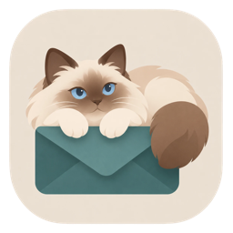
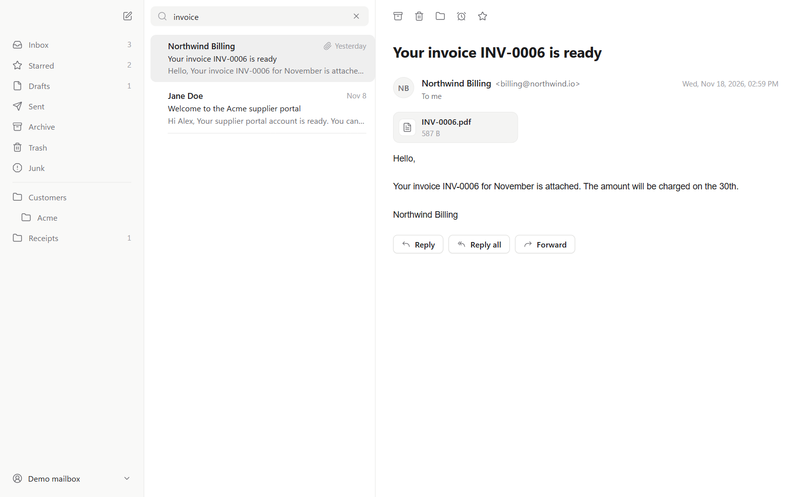
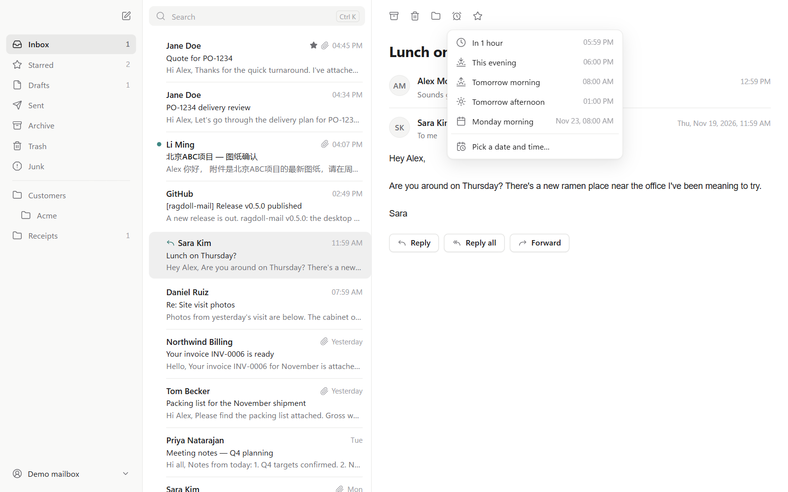
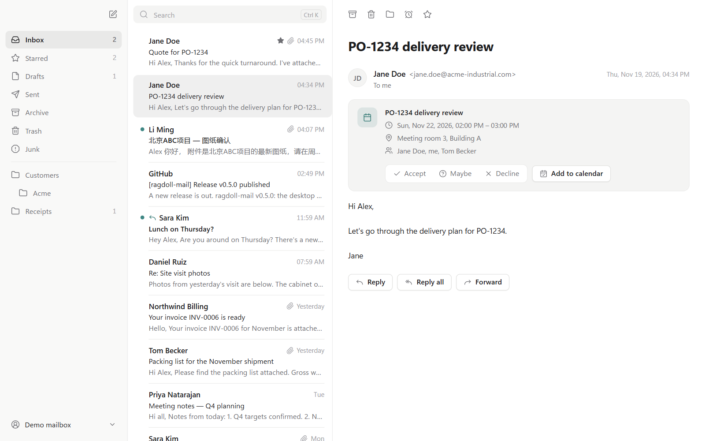

<p align="center"></p>

<h1 align="center">ragdoll-mail</h1>

<p align="center"><b>A calm, fast mail app for your computer.</b><br>Find any mail in a blink. Keep the mailbox you already have. Free.</p>

<p align="center">
  <a href="https://github.com/erict16/ragdoll-mail/releases/latest/download/ragdoll-mail-mac.dmg"></a>
  &nbsp;
  <a href="https://github.com/erict16/ragdoll-mail/releases/latest/download/ragdoll-mail-windows.zip"></a>
</p>

<p align="center"><sub>Mac (Apple silicon) and Windows 10 / 11 · English, 中文, 日本語, 한국어, Español, Français, Deutsch · free and open source</sub></p>

<p align="center">
  <picture>
    <source media="(prefers-color-scheme: dark)" srcset="docs/hero-dark.png">
    
  </picture>
</p>

## Find any mail, right away

Type a word, a name or a file name. Results show while you type, because ragdoll-mail keeps its own search index on your computer. It works on a plane too.

- Finds words inside the mail text, not only in the subject.
- Works for Chinese, Japanese and Korean as well as English.
- Narrow it down when you need to: `from:jane`, `has:attachment`, `is:unread`.

<p align="center"></p>

## Write without worry

- **Undo send.** A mail waits a few seconds before it leaves. Changed your mind? Press Undo.
- **Send later.** This evening, tomorrow morning, or any time you pick.
- **A last look before it goes.** The app tells you when you wrote "attached" and attached nothing, or left the subject empty.
- **Templates** for the answers you write again and again.
- **No internet?** Press Send anyway. The mail leaves by itself when you are back online.

<p align="center">
  <picture>
    <source media="(prefers-color-scheme: dark)" srcset="docs/compose-dark.png">
    
  </picture>
</p>

## Keep your Inbox calm

- **Snooze** a mail and it comes back, on top, at the time you choose.
- **Meeting invites** show what, when and where. Answer with one click.
- **Star** what matters. Sort mail into your own folders.
- A quiet notification for new mail and, if you like, the unread number on the app icon.

<table>
<tr>
<td></td>
<td></td>
</tr>
</table>

## Yours, and private

- **Your mail stays on your computer.** There is no ragdoll account and no ragdoll cloud. The app talks to your own mail server, and to GitHub only to ask whether a new version is out.
- **Your password is safe.** It lives in the macOS Keychain or the Windows Credential Manager, never in a file.
- **No surprise tracking.** Pictures from the internet stay hidden until you ask for them.
- Light or dark, eight languages, and a keyboard shortcut for everything (press **?** to see them).

## Get started in a minute

1. **Download** the app for [Mac](https://github.com/erict16/ragdoll-mail/releases/latest/download/ragdoll-mail-mac.dmg) or [Windows](https://github.com/erict16/ragdoll-mail/releases/latest/download/ragdoll-mail-windows.zip).
2. **Open it.** The app is not signed yet, so the first time your computer asks once:
   - Mac: right-click the app and choose **Open**.
   - Windows: choose **More info**, then **Run anyway**. (Windows 10 may also ask for Microsoft's free WebView2 runtime; Windows 11 has it.)
3. **Sign in** with your mail address and password. That is all.

It works with Gmail, iCloud, Fastmail, QQ Mail, 163, Tencent Exmail and any other mailbox that offers IMAP. Gmail and iCloud ask for an *app password*, a special password you make in your account's security settings.

## Questions

**Is it really free?** Yes. It is open source under the MIT license. No ads, no paid plan.

**Will it change my mailbox?** It works like any other mail app. What you read, star, move or send shows up on your phone and in webmail too. If you remove ragdoll-mail, your mail is still on your mail server.

**Can I keep my other mail app?** Yes. Use both. Only snoozed mail and templates live on this computer alone.

**Does it work offline?** Reading and searching mail you already have: yes. New mail and sending wait until you are online.

**Something is wrong?** [Tell us here](https://github.com/erict16/ragdoll-mail/issues/new/choose).

## For developers and AI agents

ragdoll-mail is also a command line. Your AI agent (Claude Code, Codex, or any script) can search your mail and prepare drafts, and nothing is sent until you say yes.

```console
ragdoll search invoice --since 2026-11-01 --json
ragdoll draft --reply inbox:312 --body reply.html --attach CO-4471.pdf
ragdoll check drafts:14 --reply
ragdoll send drafts:14 --yes
```

- [The command line and AI agents](docs/command-line.md): setup, every command, how drafts and updates work, how the code is laid out
- [Everything the app does](docs/features.md)
- [How it compares](docs/compare.md) with Thunderbird, Superhuman, Spark and others
- [Contributing](CONTRIBUTING.md)

Run it from the source: `pip install pywebview`, then `python ragdoll.py app`. Add `--demo` for a made-up mailbox with no account.

<p>
  <a href="https://github.com/erict16/ragdoll-mail/releases/latest"></a>
  <a href="https://github.com/erict16/ragdoll-mail/actions/workflows/build.yml"></a>
  
  <a href="LICENSE"></a>
</p>

MIT license. Icons from [Lucide](https://lucide.dev) (ISC) and [Phosphor](https://phosphoricons.com) (MIT).
