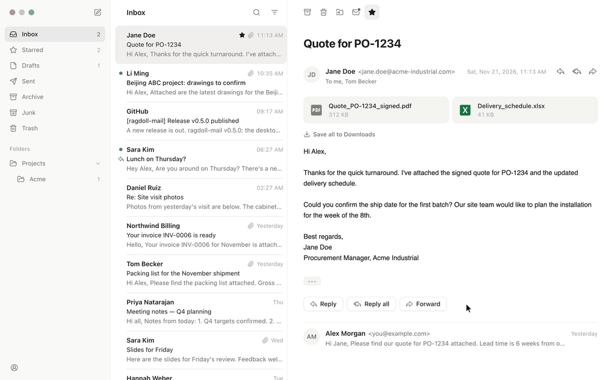
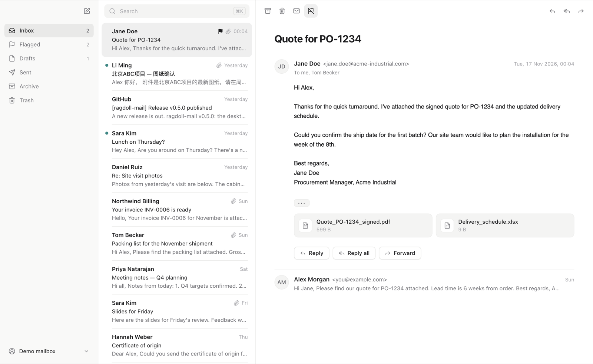
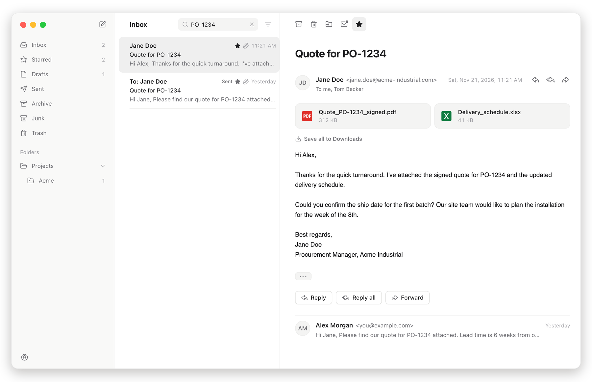
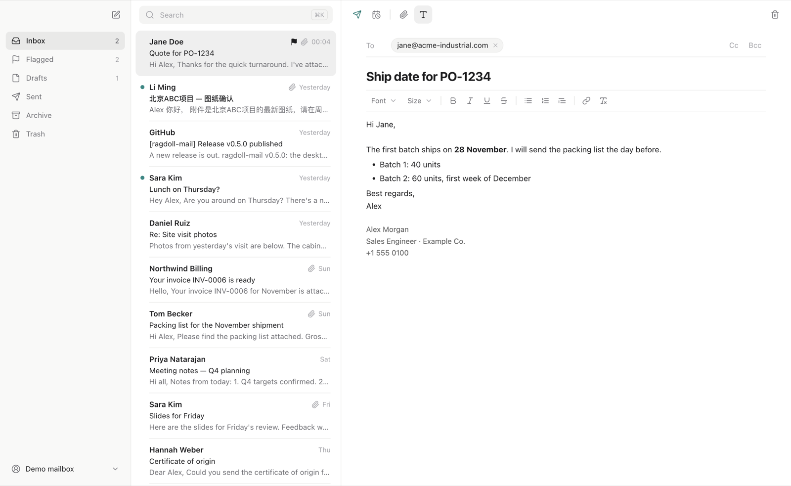
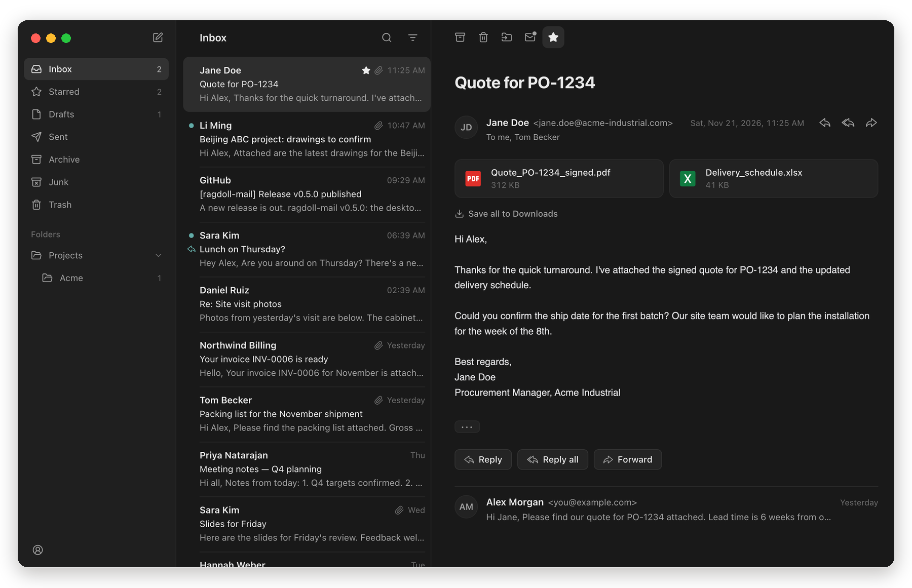

<p align="center"></p>

<h1 align="center">Ragdoll Mail</h1>

<p align="center"><b>免费的 Mac / Windows 邮箱客户端。<br>搜邮件一搜就到，邮箱自带的搜索不好用也没关系。</b></p>

<p align="center">支持腾讯企业邮箱、QQ 邮箱、163 邮箱、Gmail、iCloud、Fastmail，以及其他支持 IMAP 的邮箱。</p>

<p align="center">
  <a href="https://github.com/erict16/ragdoll-mail/releases/latest"></a>
  <a href="https://github.com/erict16/ragdoll-mail/actions/workflows/build.yml"></a>
  <a href="LICENSE"></a>
</p>

<p align="center">
  <a href="https://github.com/erict16/ragdoll-mail/releases/latest/download/ragdoll-mail-mac.dmg"><b>下载 Mac 版</b></a> ·
  <a href="https://github.com/erict16/ragdoll-mail/releases/latest/download/ragdoll-mail-windows.zip"><b>下载 Windows 版</b></a> ·
  <a href="https://erict16.github.io/ragdoll-mail/zh/"><b>官网</b></a> ·
  <a href="README.md"><b>English</b></a>
</p>

<p align="center"></p>

## Ragdoll Mail 是什么？

Ragdoll Mail 是一个收发邮件的软件，和苹果自带的“邮件”、Outlook、Foxmail 是同一类东西。用你现在的邮箱登录就能用。邮箱里什么都不会变，手机上和别的邮件软件照常用。

做它是为了解决一个问题：很多邮箱的搜索又慢又不准，腾讯企业邮箱尤其明显。Ragdoll Mail 在你自己的电脑上给邮件做了一份目录，搜索时查的是这份目录。打几个字，要找的邮件就出来了。

## 它好在哪

- **搜得到。** 输入人名、订单号，或者正文里记得的几个字，边打边出结果。中文、日文、韩文都能搜。断网也能搜。
- **邮件只在你自己手里。** 软件只和你自己的邮箱服务器打交道，中间没有别的公司经手，也没有人替你“保管”一份。密码存在系统自带的密码库里（Mac 的“钥匙串”，Windows 的“凭据管理器”）。
- **不容易发错。** 点了发送，最长有 30 秒可以撤回。正文写了“见附件”却没加附件、主题是空的、正文里还留着 `[姓名]` 这样没填的地方，软件都会先拦住你。
- **定时发送。** 现在写好，今晚发、明早发，或者自己挑个时间发。
- **中文邮件不乱码。** 老邮件系统发来的中文名字、中文附件名都能正常显示。
- **免费。** 没有广告，不用订阅，不用另外注册账号。代码公开，谁都可以查它到底做了什么。

## 两分钟用上

1. **下载。** 到[最新版本页面](https://github.com/erict16/ragdoll-mail/releases/latest)下载：
   - Mac（M1 及更新的机型）：`ragdoll-mail-mac.dmg`
   - Windows 10 / 11：`ragdoll-mail-windows.zip`
2. **打开。** 我们还没有向苹果和微软购买签名，所以第一次打开时系统会问一次：
   - Mac：提示“无法验证”时，打开 **系统设置 → 隐私与安全性**，往下拉，点 **仍要打开**。（旧版 macOS：右键点软件，选 **打开**。）
   - Windows：点 **更多信息**，再点 **仍要运行**。
3. **登录。** 填邮箱地址和密码。上面列出的那些邮箱，以及用腾讯企业邮箱、Google Workspace、阿里或网易企业邮箱的公司邮箱，服务器设置都会自动填好。用腾讯企业邮箱的，可以看 [腾讯企业邮箱设置指南](https://erict16.github.io/ragdoll-mail/zh/exmail/)。

第一次登录后，软件要把邮箱读一遍，邮件多的话需要几分钟。这期间可以照常看邮件、写邮件。

> **填哪个密码？** 很多邮箱要求邮件软件用一个专门的密码，不是网页登录的那个。腾讯企业邮箱叫“客户端专用密码”，QQ 邮箱和 163 邮箱叫“授权码”，Gmail、iCloud、Fastmail 叫“应用专用密码”。到邮箱网页版的设置里生成就行。

## 能做什么

**看邮件**
- 一来一回的邮件排在同一页，最新的在上面。引用的旧内容自动收起。
- 点图片可以放大看。附件可以一个一个存，也可以一次全存。
- 鼠标停在链接上，先看到它通向哪里，再决定点不点。
- 会议邀请直接显示主题、时间和地点，一键添加到日历。
- 订阅邮件的发件人旁边有「退订」，点一下就不再收到。

**找邮件**
- 按 ⌘K（Mac）或 Ctrl+K（Windows）直接打字。主题、收发件人、正文、附件名都会搜。
- 想更准一点：`from:张三`、`is:unread`、`has:attachment`、`in:sent`。
- 只看未读、只看星标、只看带附件的，或者只看某个人发来的。

**写邮件**
- 字体、字号、加粗、列表、链接都有。从 Word 或网页粘贴过来，格式还在。
- 签名自动加在每封邮件下面。
- 回复和转发会带上之前的邮件和里面的图片。
- 可以撤回，可以定时发送。

**整理邮件**
- 邮箱里的文件夹都在左边。可以自己新建，把邮件拖进去。
- 加星标、归档、删除、移动，一封或者一次选很多封都行。右键点邮件也是这些操作。
- 整个文件夹一键标为已读。
- 来新邮件时有通知。

**按自己的习惯来**
- 浅色、深色。
- 界面语言：简体中文、繁體中文、English、日本語、한국어、Español、Français、Deutsch。
- 文字可以调大调小。
- 所有操作都有快捷键：**C** 写邮件，**R** 回复，**E** 归档。按 **?** 看全部。

## 截图

<table>
<tr>
<td></td>
<td></td>
</tr>
<tr>
<td></td>
<td></td>
</tr>
</table>

## 和别的邮件软件比

|  | **Ragdoll Mail** | 苹果“邮件” | 新版 Outlook | Thunderbird | Foxmail | Spark |
|---|:---:|:---:|:---:|:---:|:---:|:---:|
| 价格 | 免费 | 免费 | 免费版有广告，或付费 | 免费 | 免费 | 有免费版和付费版 |
| Mac 和 Windows | 都有 | 只有 Mac | 都有 | 都有 | 都有 | 都有 |
| 邮件只在你和邮箱服务器之间走 | ✅ | ✅ | 会在微软云端存一份 | ✅ | ✅ | 要经过 Spark 的服务器 |
| 代码公开，谁都能查 | ✅ | 否 | 否 | ✅ | 否 | 否 |
| 你自己的 AI 助手可以用这个邮箱 | ✅ | 否 | 否 | 否 | 否 | 否 |
| 手机版 | 没有 | ✅ | ✅ | 安卓 | 没有 | ✅ |
| 一个窗口里看多个邮箱 | 还没有 | ✅ | ✅ | ✅ | ✅ | ✅ |

**Ragdoll Mail 强在哪：** 搜索、隐私、发送前的检查、中文邮件。它很小，只做邮件这一件事。

**别人强在哪：** Ragdoll Mail 没有手机版，没有日历，一次只能看一个邮箱。需要这些的话，用别的软件，或者两个一起用都可以：Ragdoll Mail 不会改动你邮箱里的任何东西。

<sub>根据各产品公开的页面整理，2026 年 11 月。有写错或过时的地方？<a href="https://github.com/erict16/ragdoll-mail/issues">告诉我们</a>，马上改。</sub>

## 常见问题

**腾讯企业邮箱有没有搜索好用的 Mac / Windows 客户端？**
有，就是这个。我们拿一个真实的企业邮箱试过，里面有 6,442 封邮件。邮箱自带的搜索不管输入什么词，都返回 4,988 封，连随手编的词也一样。Ragdoll Mail 只返回真正含这个词的邮件，用时不到 0.1 秒。

**我的邮件安全吗？**
邮件只存在两个地方：你的电脑，和你自己的邮箱服务器。软件不会把任何东西发给我们。我们根本没有服务器。

**密码存在哪里？**
存在系统自带的密码库里：Mac 的“钥匙串”，Windows 的“凭据管理器”。不会写进任何文件。

**没有网能用吗？**
看已经收下来的邮件、搜索邮件：可以。发邮件和收新邮件要联网。

**会不会把我的邮箱弄乱？**
不会。你看到的文件夹和邮件，和邮箱网页版里的一样。在软件里做的事（已读、移动、删除、发送），手机上和网页版里也同样看得到。

**可以先试试，不登录自己的邮箱吗？**
可以。把代码下载到电脑上，运行 `python ragdoll.py app --demo`，打开的是一个编出来的示例邮箱，什么都不会发出去。

**真的免费吗？**
真的。MIT 开源许可。

## 给 AI 助手和命令行用

Ragdoll Mail 还带一个命令 `ragdoll`。Claude Code、Codex 这样的 AI 助手可以用它帮你找邮件、写草稿。它自己发不了邮件：每封都先放在草稿箱里，等你点头才发。

```console
你    › 回复 Jane，把签好字的报价单附上。
助手  $ ragdoll search Jane quote --json
助手  $ ragdoll draft --reply inbox:312 --body reply.html --attach Quote.pdf
助手  › 草稿已经放进草稿箱了，要发吗？
```

装命令：在 App 里点 **设置 → 命令行 → 安装**。有哪些命令、和 Gmail API 比怎么样：看 **[命令行说明](docs/command-line.md)**（英文）。

## 反馈

遇到问题，或者你的邮箱用不了？[提一个 issue](https://github.com/erict16/ragdoll-mail/issues)。想帮忙写代码或翻译？看 [CONTRIBUTING.md](CONTRIBUTING.md)。

## 许可

MIT。图标来自 [Lucide](https://lucide.dev)（ISC）；文件类型图标来自 [Material Design Icons](https://pictogrammers.com/library/mdi/)（Apache-2.0）。
